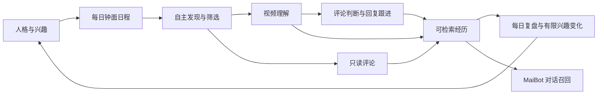

# MaiBot BiliLife · 麦麦的 B 站生活

[](https://github.com/ANTINOVIA/maibot-bililife/releases/tag/v0.2.6)
[](LICENSE)

根据 MaiBot 的人格、兴趣和近期经历安排 B 站生活：自主发现内容，理解视频或只阅读评论，决定是否互动，保存带来源的经历，并在后续对话中检索使用。通过 MaiBot 自带 WebUI 管理，无需独立前端或数据库服务。

插件 ID：**`antinova.maibot-bililife`**。

本文对应当前 **0.2.6 发布源码与安装包**。接口定义以 [plugin.py](plugin.py)、[WebUI 声明](webui.json) 和 [webui_service.py](webui_service.py) 为准；业务默认值与校验以 [configuration.py](configuration.py) 为准。内部 Python 类方法不作为公共远程接口承诺。

## 导航

- [功能与安装](#功能与安装)
- [配置文件与保存规则](#配置文件与保存规则)
- [全部业务配置](#全部业务配置)
- [模型提供商与路由](#模型提供商与路由)
- [公共接口调用约定](#公共接口调用约定)
- [查询接口](#查询接口)
- [控制与任务接口](#控制与任务接口)
- [配置与模型接口](#配置与模型接口)
- [互动与记忆接口](#互动与记忆接口)
- [维护接口](#维护接口)
- [MaiBot 记忆检索工具](#maibot-记忆检索工具)
- [数据状态与存储](#数据状态与存储)

## 功能与安装



| 页面 | 主要功能 |
| --- | --- |
| 总览 | 账号、当前任务、今日进度、额度与异常 |
| 每日安排 | 24 小时钟面、主计划版本、自主追加、重新生成、插入、取消与删除 |
| 浏览与理解 | 自主搜索、UP 主内容、视频经历、只读评论经历、证据与覆盖范围 |
| 评论与回复 | 草稿编辑、独立自动发布开关、发布核对与相关线程 |
| 经历记忆 | 检索、纠错、遗忘、来源与宿主上下文状态 |
| 兴趣与人格 | 新增、编辑、重命名和删除兴趣，权重调整、冻结及变更记录 |
| 模型 | 直选 MaiBot 模型、独立提供商、协议配置、连接检查延迟及错误码 |
| 设置总览 | 跳转各模块、TOML、独立 B 站扫码 |
| 运行记录 | 脱敏审计、模型调用、资源设置与数据库备份 |

清单声明的宿主兼容范围为 **MaiBot 1.3.14–1.3.99**，SDK 仍限定为 **maibot-plugin-sdk 2.16.0**；插件类型为 `integration`（外部平台集成）。实际验证环境为 **MaiBot 1.3.14 / SDK 2.16.0 / Dashboard 1.9.8 / Python 3.12**，范围内其他宿主补丁版本尚未逐一验证。关键帧、ASR、音频和视频片段处理需要服务器可执行的 FFmpeg。

1. 从 [Releases](https://github.com/ANTINOVIA/maibot-bililife/releases/tag/v0.2.6) 下载 `antinova.maibot-bililife-0.2.6.zip`，核对同名 SHA256 文件，在 MaiBot 插件管理导入并启用。官方插件中心通过该 Release 标签的固定提交安装；手动导入使用附件中的插件 ZIP。
2. 打开 BiliLife **设置总览**生成二维码，使用 B 站客户端完成独立扫码。
3. 在**模型**选择文本模型及需要的媒体模型；在**浏览与理解**选择理解方式、兴趣主题与每日额度。
4. 在**每日安排**生成计划或等待自动生成。日程可包含只读评论，不要求预先指定视频。
5. 需要自动互动时分别开启评论/回复自动发布；默认两者都关闭。顶部始终可暂停任务或停止新发布。

只取得标题与简介时标记为“元数据浏览”。字幕、画面和媒体片段保留实际范围；只读评论不冒充看过视频，也不据此发布视频评论。视频输入为有界片段，不是无限实时视频流。

视频理解的每条 `details` 可在 `evidence_id` 指定一个已提供的来源：字幕的 `source_id`（例如 `subtitle_3`）、元数据的 `metadata:title` / `metadata:description`，或一个完整媒体标签（例如 `frame_1@20.0s`、`video_segment_1@0-90s`、`audio_segment_1@0-90s`，位置以实际资料为准）。此时 `evidence_quote` 可为空，由后端填入该来源前 180 字以内的原文；也可直接逐字填写引用。两个字段同时填写时，引用必须属于指定来源。后端仅兼容空白差异及时间相邻字幕的断句，并保存匹配到的原文，不接受改写或拼接远距离抽样。观察描述写入 `details[].text`，不能用自行概括、OCR 或听写替代已取得的原文。校验失败后携带上次结果和错误条目修复一次，两次均失败则任务报错，不生成发布草稿；脱敏日志记录失败引用和来源编号。来源编号用于定位资料，并不代表对模型观点的事实认证。

## 配置文件与保存规则

“重新排队”只恢复任务执行状态，不扣除或重置额度。同一天、同一视频分 P 的重试共用一次视频条数和浏览时长额度，记录持久保存，重启后继续生效；跨日再次执行按实际执行日结算。重试实际产生的模型调用、Token 和下载流量仍照常计入资源消耗。重新排队不会返还已发生的消耗，也不会解除评论发布限制或重发结果未知的操作。

| 文件 | 内容与入口 |
| --- | --- |
| 插件 `config.toml` | 宿主插件开关与配置格式版本，示例 [config.example.toml](config.example.toml) |
| `data_dir/settings.toml` | 业务配置，按下文 10 个模块分节；页面保存立即生效并维护 SQLite 快照 |
| `data_dir/model-routing.json` | 提供商非秘密字段、五个模型用途路由与宿主媒体协议，由模型页管理 |
| `data_dir/model-secrets.json` | 独立模型密钥与绑定的服务地址，仅后端保存 |
| `data_dir/credential.json` | 独立扫码得到的 B 站凭据，仅后端保存 |

`data_dir` 由宿主 `ctx.paths.data_dir` 提供，不是源码目录。完整默认模板见 [settings.example.toml](settings.example.toml)，JSON 平铺默认值见 [settings.example.json](settings.example.json)。模型专用 TOML 必须在模型入口提交，不能混入业务配置。

- `settings_patch` 和 TOML 保存按当前配置合并，只更新提交的字段；模块入口拒绝跨模块字段。`save_settings` 将提交的平铺 JSON 重新构造成完整 Settings，省略字段会回到代码默认值，因此通常应先读取 settings 快照。
- 类型严格区分：数字不能写成字符串，布尔值不能用 `0/1`；未知字段被拒绝。下表默认值是安装默认值，不覆盖已保存的个人设置。
- 手动编辑服务器 `settings.toml` 后需重载插件；非法文件保留上次有效设置并在总览报告 `config_error`。页面保存则立即生效。
- 旧 `mode`、`concurrency`、`allowed_videos` 和三个媒体开关仅用于启动迁移，新接口不再接受它们。旧媒体开关按原有效路径迁移为 `video_understanding_mode`。
- 所有额度都是上限。失败调用可能已经消耗资源，不能将重试视为免费。每天按业务日期独立结算，不通过重启清空消耗。

### 宿主插件配置

| 配置项 | 类型 / 默认值 | 含义与影响 |
| --- | --- | --- |
| `plugin.enabled` | bool / `true` | 加载时为 false 会暂停调度；运行时改为 false 触发暂停。改回 true 不等于执行“继续全部任务”，仍需检查暂停状态。 |
| `plugin.config_version` | str / `"0.1.0"` | SDK 配置格式版本，不是插件发行版本；由插件维护，勿自行改成 0.2.6。 |

## 全部业务配置

下表节名用于 TOML；API 的 Settings 是**平铺对象**，例如 `{"max_videos":4}`，而非 `{"browse":{"max_videos":4}}`。时间使用业务时区，容量单位为 MiB（1024² 字节）。

### `[schedule]` · 每日安排

| 配置项 | 类型 | 默认值 | 允许值 | 含义与取值影响 |
| --- | --- | --- | --- | --- |
| `planner_enabled` | bool | `true` | true / false | 自动在 plan_time 后为当日生成主计划；关闭后仍可手动生成，不会取消已有计划。 |
| `adaptive_schedule_enabled` | bool | `true` | true / false | 视频理解后允许麦麦评估并追加日程；关闭后不再触发新的自主追加。 |
| `max_dynamic_tasks` | int | `3` | 0～10 | 每天自主追加的任务总数上限，0 表示不追加；单次模型提议最多 2 项。 |
| `schedule_task_minutes` | int | `30` | 3～60 分钟 | 浏览、发现和只读评论的时段上限；自动计划通常规范到 15 分钟至此值之间（上限低于 15 时以用户上限为准），即时浏览、后续观看与手动插入的默认时段也使用此值。与后台执行超时分开。显式手动填写结束时间时保留用户时段，不改动已有任务。 |
| `schedule_brief_minutes` | int | `15` | 5～30 分钟 | 回复、评论、记忆整理和复盘采用较轻量的时段，自动计划为 5 分钟至此值之间，默认入队窗口使用此值。后台实际调用仍受 task_timeout_seconds 限制。 |
| `schedule_gap_minutes` | int | `30` | 0～180 分钟 | 同一批相邻活动之间的最小自由间隔，也用于分开多个后续观看；显式休息前后不重复添加间隔。0 允许连续安排。过密提议会顺延，超出当天或活跃范围则校验失败。 |
| `schedule_rest_minutes` | int | `60` | 15～360 分钟，且 ≤schedule_rest_max_minutes | 自动休息的最短时段，也是手动插入未填写结束时间时的默认休息长度。新浏览和发布在休息区间内暂停；内部整理和发布结果核对仍可运行。可从日程删除该休息项提前结束。 |
| `schedule_rest_max_minutes` | int | `180` | 15～360 分钟，且 ≥schedule_rest_minutes | 自动休息时段的上限，允许午休或放空有不同长度；临近业务日结束时按剩余当日时间截断，不跨日延伸。未排任务的空白也可保留为自由时间。 |
| `timezone` | str | `"Asia/Shanghai"` | 有效 IANA 时区 | 决定业务日期、活跃时段、计划与额度归属。已有发布记录时 API 拒绝更改，需先处理额度迁移。 |
| `plan_time` | str | `"09:00"` | HH:MM | 每日到此时间后，若无有效主计划及待执行生成任务则自动入队；停机后当日恢复也会补检查。 |
| `active_start` | str | `"09:00"` | HH:MM | 浏览、只读评论、发布和回复任务的活跃开始时间；与结束时间相同时仅该分钟活跃。 |
| `active_end` | str | `"22:30"` | HH:MM | 活跃结束时间，边界包含在内；开始晚于结束时表示跨午夜时段。休息时外部生活任务等待，但仍受截止时间约束。 |
| `task_timeout_seconds` | int | `300` | 30～1800 秒 | 一般即时任务默认执行超时；手动日程 duration 的上限，计划任务实际超时取提议与此值的较小值。扫码、账号及模型诊断另设时限。 |
| `max_retries` | int | `2` | 0～4 | 可重试网络读取失败后的额外重试次数，0 不重试；退避为 min(300,15×2^attempts) 秒。公开发布不按此设置盲目重试。 |

### `[browse]` · 浏览与理解

| 配置项 | 类型 | 默认值 | 允许值 | 含义与取值影响 |
| --- | --- | --- | --- | --- |
| `browsing_enabled` | bool | `true` | true / false | 控制发现、探索、观看和只读评论；关闭后执行入口阻止这些任务。 |
| `max_videos` | int | `4` | 0～20 条/日 | 每天进入理解流程的视频条数上限，0 阻止新增观看；失败不保证退还已预留条数。只读评论单独计数。 |
| `max_comment_sessions` | int | `4` | 0～20 次/日 | 独立 read_comments 经历上限，0 阻止新增阅读会话；已建立的失败阅读重试复用原会话。 |
| `max_comments_read` | int | `12` | 1～20 条 | 只读评论每次取得的评论条数上限；实际可能少于此值，不代表读完整个评论区。互动判断的上下文另有固定 8 条抽样。 |
| `max_video_seconds` | int | `900` | 30～7200 秒 | 单个分 P 的允许时长；超过就跳过整条内容，不会仅截短后继续观看。也参与媒体片段长度上限计算。 |
| `max_browse_seconds` | int | `2400` | 60～14400 秒/日 | 按被选中视频的完整分 P 时长预留每日浏览时间，即使实际只抽帧或分析短片；不是下载或模型耗时。 |
| `allowed_topics` | list[str] | `["科学","技术","日常生活"]` | 最多 30 项；每项非空且 ≤80 字符 | 允许主题与兴趣初始来源；自主检索词须包含其中至少一个主题。自动评论/回复要求此项或 allowed_uploaders 非空。 |
| `excluded_topics` | list[str] | `[]` | 最多 30 项；每项非空且 ≤80 字符 | 按子串排除检索词以及标题/简介命中的视频；优先于允许范围。 |
| `allowed_uploaders` | list[str] | `[]` | 最多 30 项；每项为数字 UID 字符串且 ≤80 字符 | 非空时限制视频作者为列表中的 UP 主；空数组按允许主题筛选。指定 UP 主发现任务要求 UID 已在此列表。 |
| `video_understanding_mode` | str | `"frames"` | frames / video / audio / subtitle | 单选媒体路径：抽帧使用 vision，视频片段使用 video，音频片段使用 audio，subtitle 不主动取画面；所有方式先尝试字幕。不会因模型已配置而自动切换路径。 |
| `max_frames` | int | `3` | 0～8；frames 模式须 ≥1 | 本地关键帧数量，按视频时长均匀取样；仅 frames 模式生效。与 Qwen 服务端 video_max_frames 无关。 |
| `enable_asr` | bool | `false` | true / false | 无可用字幕且有可访问音轨时额外调用 ASR；可与任一理解方式组合。转录文字不等于模型分析了声音。 |
| `segment_seconds` | int | `90` | 15～300 秒 | 音频、视频及 ASR 片段的期望长度；实际为 min(视频时长,此值,120,max_video_seconds)，设置超过 120 不会扩大当前处理范围。 |
| `max_download_mb` | int | `40` | 1～200 MiB | 单视频媒体读取总上限，视频和音频共用；字幕读取另有 2 MiB 请求上限。提高后允许更大下载，但仍受每日额度限制。 |
| `daily_download_mb` | int | `120` | 1～1000 MiB/日 | 按实际接收的媒体/字幕字节计数；达到上限阻止新增下载，连接检查不计入此项。 |

### `[comments]` · 视频评论

| 配置项 | 类型 | 默认值 | 允许值 | 含义与取值影响 |
| --- | --- | --- | --- | --- |
| `comments_enabled` | bool | `true` | true / false | 控制视频评论草稿和发布；关闭时 auto_publish_comments 自动归零。已有草稿保留。 |
| `auto_publish_comments` | bool | `false` | true / false | 开启后，麦麦生成且满足规则的评论草稿自动入队，无需逐条确认；人工草稿不会被自动接管。仍受暂停、停发、范围、额度和去重约束。 |
| `comment_prompt` | str | 内置中文风格要求，完整默认值见 [settings.example.toml](settings.example.toml) 的 comments 节 | 0～3000 字符 | 评论与回复的可编辑风格提示词，也用于互动判断。默认按宿主人格回应一个具体细节，通常一两句，避免助手汇报、学习承诺、报告式总结和空泛夸赞；证据不足时保持沉默。不修改核心人格与权限。保存后影响后续生成，已有草稿不自动重写。空字符串表示不添加这段管理员风格要求，内置证据与权限规则仍生效。 |
| `comment_avoid_phrases` | list[str] | `["我记下了","我记住了","已记录","受益匪浅","值得深入探讨","作为AI"]` | 最多 30 项；每项 1～80 字符且非全空白 | 生成后、入发送流程前及实际发送前检查评论与回复正文，兼容全半角、空白和标点差异。命中时生成阶段最多重写一次，仍命中则停止保存/发布；已有或人工草稿命中也不能发布。主人提及名称不参与表达检查。`[]` 关闭这项措辞检查，其他发布检查继续生效。 |
| `owner_uid` | str | `""` | 空字符串或 ASCII 正整数；长度 ≤19 且 <2^63 | 主人 B 站 UID；留空不添加提醒。非空时解析真实账号名称与平台提及字段，不用 @数字 冒充提及。 |
| `mention_owner` | bool | `true` | true / false | 新生成的视频评论是否追加主人提醒；需要 owner_uid 非空且不同于当前账号。不自动修改旧草稿，回复不反复追加。 |
| `max_comments` | int | `1` | 0～10 条/日 | 每日视频评论上限；待发送、发送中、未知和成功操作均参与额度检查，0 阻止发布。 |
| `max_per_video` | int | `1` | 1～3 条 | 当前账号对同一视频理解记录的累计视频评论上限，跨日累计；不是每日每视频额度。 |
| `cooldown_seconds` | int | `3600` | 60～86400 秒 | 同一视频记录上任意评论/回复之间的冷却时间，跨日也检查。 |

### `[replies]` · 回复跟进

| 配置项 | 类型 | 默认值 | 允许值 | 含义与取值影响 |
| --- | --- | --- | --- | --- |
| `replies_enabled` | bool | `true` | true / false | 控制相关回复检查、草稿和发布；关闭时 auto_publish_replies 自动归零。 |
| `auto_publish_replies` | bool | `false` | true / false | 允许麦麦生成的回复草稿自动发布；仅跟进当前账号已发布评论的相关线程，仍可选择不回复。 |
| `max_replies` | int | `2` | 0～20 条/日 | 每日回复发布上限，0 阻止发送回复；独立于 max_comments。 |
| `max_thread_rounds` | int | `2` | 1～5 | 同一 root 字段下当前账号累计发布操作数量上限；按本地操作计数，并非严格的双方一来一回轮数。 |
| `user_cooldown_seconds` | int | `21600` | 60～604800 秒 | 向同一 target_uid 回复的最短间隔，跨视频、跨日检查。 |
| `reply_interval_seconds` | int | `3600` | 900～86400 秒 | 登录正常且处于活跃时段时，自动安排回复检查的最短周期；不会要求等到次日。 |

### `[memory]` · 经历与记忆

| 配置项 | 类型 | 默认值 | 允许值 | 含义与取值影响 |
| --- | --- | --- | --- | --- |
| `memory_enabled` | bool | `true` | true / false | 控制新记忆提取、只读评论记忆保存和经历检索；关闭不删除已有数据，编辑/遗忘接口仍可使用。 |
| `recall_limit` | int | `4` | 1～8 条 | 一次检索最多返回的记忆数量；按相关性、重要度和时间综合排序，还受 recall_chars 限制。 |
| `recall_chars` | int | `2400` | 200～6000 字符 | 一次检索的文本与来源预算；正文会截断，来源长度参与预算扣减，返回元数据与注入包装不属于这个正文预算。 |

### `[persona]` · 兴趣与人格干预

在“兴趣与人格”的列表中，点击“编辑兴趣”可修改主题名称、权重和冻结状态，修改原因选填。更名会替换原主题并同步允许主题，不会留下重复项。点击“删除”并确认后，会从兴趣和允许主题中移除该项，重启后不会因旧配置重新出现；已有经历、记忆及变更记录保留，已安排的日程不会自动取消。删除不会自动加入排除主题。若没有剩余允许主题或指定 UP 主，评论和回复的自动发布开关会关闭；新增主题不会自动重新开启它们。列表支持分页。

| 配置项 | 类型 | 默认值 | 允许值 | 含义与取值影响 |
| --- | --- | --- | --- | --- |
| `evolution_enabled` | bool | `true` | true / false | 允许复盘依据至少 3 个不同 BV 的理解经历评估兴趣变化；单次最多 4 个主题、每项增量 ±0.05、权重夹在 0～1。每天不重复累加已产生的自动变更，冻结项不变，人工干预不受此开关限制。 |
| `persona_guidance` | str | `""` | ≤2000 字符 | 管理员对 BiliLife 的人格补充与近期偏好；生成内容时随宿主人格输入，保存历史并支持回滚，不改宿主核心人格。 |
| `expression_preferences` | list[str] | `[]` | 最多 12 项，每项 ≤200 字符 | 表达偏好列表，随人格上下文进入生成流程；修改与 persona_guidance 一起版本化记录。 |

### `[review]` · 每日复盘

| 配置项 | 类型 | 默认值 | 允许值 | 含义与取值影响 |
| --- | --- | --- | --- | --- |
| `review_enabled` | bool | `true` | true / false | 控制复盘任务与每日自动触发；关闭时手动入队的复盘也会被模块检查阻止。 |
| `review_time` | str | `"22:00"` | HH:MM | 每日到此时间后检查是否需生成复盘；自动触发有防重复逻辑，手动复盘可修订当日摘要。 |
| `summary_stream_id` | str | `""` | 宿主可用的会话 ID；空字符串不推送 | 复盘成功后调用宿主 send.text 推送到唯一指定会话；不广播所有群聊。没有额外的 ID 格式校验，发送权限由宿主处理。 |

### `[models]` · 模型与调用预算

| 配置项 | 类型 | 默认值 | 允许值 | 含义与取值影响 |
| --- | --- | --- | --- | --- |
| `max_model_calls` | int | `24` | 0～200 次/日 | 生活模型请求次数上限，含筛选、规划、ASR 和有限结构修复；0 阻止新生活推理。连接检查独立，不受此限额阻挡。 |
| `max_tokens` | int | `70000` | 0～1000000 Token/日 | 生活推理先保守预留，再按提供商 usage 结算；缺失 usage 时保留预扣，实际报告超额仍记账。0 阻止新增生活推理。 |
| `output_tokens` | int | `1600` | 256～4096 Token | 生活模型单次输出上限，也参与输入预算预留；增大可容纳更长结构，同时提高额度预留。诊断固定使用 256。 |
| `model_timeout_seconds` | int | `100` | 10～300 秒 | 普通模型请求最长等待时间；诊断取 min(此值,30)，整体还受任务时限约束。 |
| `text_model_task` | str | `"utils"` | 宿主存在的文本任务角色名称 | 旧空路由的文本 SDK 默认任务角色；显式选 host:模型名 时仍传此任务名并指定模型。普通用户优先在模型页直选模型。 |
| `vision_model_task` | str | `"vlm"` | 宿主存在的视觉任务角色名称 | 关键帧视觉 SDK 的任务角色；用途与文本角色相同，原始视频不走该角色。 |
| `asr_model_task` | str | `"voice"` | 宿主存在的 ASR 任务角色名称 | 宿主语音转录角色；无可用 ASR 时不要仅打开 enable_asr。角色字符串未在 Settings 中枚举，实际由宿主验证。 |

### `[resources]` · 存储与运行维护

| 配置项 | 类型 | 默认值 | 允许值 | 含义与取值影响 |
| --- | --- | --- | --- | --- |
| `max_storage_mb` | int | `256` | 32～2048 MiB | 按专属数据目录下 SQLite 文件及 runtime 直属文件统计；超额阻止新增耗资源任务，不自动删除记忆或发布记录。账号、扫码、核对、休息和诊断例外。 |
| `retention_days` | int | `60` | 7～365 天 | 清理 audit、model_calls、reply_events 中过期记录；不据此自动删除计划、理解、记忆或发布 outbox。清理每天检查一次。 |
| `cache_hours` | int | `12` | 1～168 小时 | 每日清理时删除 runtime 目录中修改时间过旧的直属缓存文件；不是精确到小时触发的定时删除。 |

### `[prompts]` · 运行提示词

| 配置项 | 类型 | 默认值 | 允许值 | 含义与取值影响 |
| --- | --- | --- | --- | --- |
| `prompt_overrides` | dict[str,str] | `{}` | 最多 12 键；每值 ≤2000 字符 | 管理员阶段补充说明，默认空；允许键见下文。只影响生成说明，不授予模型修改权限、预算或账号的能力。 |

`prompt_overrides` 允许键为 `plan`、`discover`、`adapt`、`read_comments`、`select`、`understand`、`decide`、`comment`、`reply`、`memory`、`evolution`、`review`。默认 `{}`；不在本文展开内置提示词正文。

### 常用 TOML 示例

以下为可合并的局部业务配置；在浏览模块入口仅提交 `[browse]`，统一入口可同时提交多节：

```toml
[browse]
max_videos = 4
max_comment_sessions = 4
max_comments_read = 12
allowed_topics = ["科学", "技术", "日常生活"]
excluded_topics = []
allowed_uploaders = []
video_understanding_mode = "frames"
max_frames = 3
enable_asr = false
segment_seconds = 90

[comments]
auto_publish_comments = false
owner_uid = ""
mention_owner = true
max_comments = 1

[replies]
auto_publish_replies = false
max_replies = 2
```

选择 `frames` 需配置 `vision` 路由；选择 `video` 需配置 `video` 路由。两者互斥。媒体分析依赖 FFmpeg，字幕缺失不会被伪装成已完整观看；媒体模型禁用或失败时如实报告限制或任务错误。

## 模型提供商与路由

### 五个用途

| 路由键 | 用途 | 新建路由状态的默认值 | 取值与影响 |
| --- | --- | --- | --- |
| `text` | 规划、筛选、文字理解、互动、记忆、复盘 | `""` | 空字符串为兼容旧设置的 SDK 任务角色；建议显式选择模型 |
| `vision` | 关键帧图片理解 | `""` | 空字符串使用宿主视觉任务角色；抽帧方式通过此用途理解 |
| `asr` | 音频转录 | `""` | 空字符串使用宿主 ASR 任务角色；没有可用模型时应关闭 ASR |
| `audio` | 原始音频片段理解 | `"disabled"` | 必须选具体条目或禁用，不能填空字符串 |
| `video` | 原始视频片段理解 | `"disabled"` | 必须选具体条目或禁用，与 vision 分开配置 |

每个用途可选 `host:MaiBot模型名称`、独立提供商 `id`、`disabled`；宿主 embedding 模型不会列为路由选项。`host:` 后是宿主配置中的 `name`，不是服务商 model ID。独立条目必须声明对应用途。页面快照会把旧空路由显示为可推导的宿主模型或 disabled，但运行时空路由仍是 SDK 兼容路径。

选择宿主模型时，文本、关键帧视觉和 ASR 通过 `ctx.llm` 调用；`audio` / `video` 原始片段理解因当前 SDK 缺少对应输入接口，由插件后端引用宿主模型 ID、地址与密钥，按所选协议直接请求模型提供商，不经过 `ctx.llm`，因此不能假定这些请求会进入宿主 SDK 的调用统计或统一路由。插件仍执行自身预算检查并记录调用；路径与取舍见 [模型说明](docs/MODEL_PROVIDERS.md)。

`model_routes` 保存时必须提交完整五个路由键。带 `[host_options.audio]` / `[host_options.video]` 的输入只影响**宿主直接媒体模型**；独立模型使用自身字段。省略整个 host_options 保留原值，提交时按整个对象替换，不逐用途合并。

```toml
[routes]
text = "host:替换为MaiBot文本模型名称"
vision = "host:替换为MaiBot视觉模型名称"
asr = "disabled"
audio = "disabled"
video = "custom_qwen_video"

[host_options.video]
protocol = "qwen_compatible"
video_has_audio = false
video_fps = 1.0
video_max_frames = 16
qwen_disable_thinking = true
```

这里 `custom_qwen_video` 需先用 `provider_save` 创建；选择独立模型时，此例 host_options 不覆盖其配置。

### 提供商全部字段

输入为一个 JSON 对象或一份 TOML。保存是按 `id` 完整替换该条目的普通字段；省略字段使用默认值。密钥按单独规则处理。最多保存 12 个条目。

| 字段 | 类型 / 默认值 | 允许值、含义与影响 |
| --- | --- | --- |
| `id` | str / 必填 | `^[a-zA-Z][a-zA-Z0-9_-]{0,39}$`；持久标识，路由通过它引用。换 ID 会创建另一条目。 |
| `name` | str / 必填 | 1～80 字符，页面显示名称。 |
| `source` | str / `"custom"` | `custom` 独立提供商；`maibot` 为兼容的宿主引用条目，通常直接用 host: 选择即可。 |
| `host_model_name` | str / `""` | 最长 150 字符；source=maibot 时必须是实际宿主模型名称，后端引用其模型 ID、地址与密钥。 |
| `base_url` | str / `""` | 最长 500 字符；custom 时必填公网 HTTPS Base URL，仅 443/8443，不含用户信息、查询参数或 fragment；连接时拒绝解析到私网。 |
| `model` | str / `""` | 最长 150 字符；custom 时必须非空，为服务商实际模型 ID，不能只填自定义显示名称。 |
| `capabilities` | list[str] / `["text"]` | 非空、不重复，只能为 text / vision / asr / audio / video；这是用户声明，不会令模型获得原本不支持的输入能力。 |
| `protocol` | str / `"openai_compatible"` | 四种协议见下表；决定地址后缀、请求内容及返回解析。 |
| `video_has_audio` | bool / `false` | 视频片段是否合并可访问音轨；条目需同时声明 video 和 audio。仅视频方式使用；模型也须真正支持音画联合输入。 |
| `video_fps` | float / `1.0` | 0.1～10；Qwen 视频输入的服务端抽帧频率，影响采样精度与模型消耗；通用 OpenAI/Gemini 路径不使用此字段。 |
| `video_max_frames` | int / `16` | 1～64；仅 DashScope 原生视频输入发送 max_frames，兼容接口不发送；服务商还可能有更严格的模型限制。 |
| `qwen_disable_thinking` | bool / `true` | Qwen 专用协议发送 enable_thinking=false；false 表示不传该参数，不代表强制开启思考模式。用于兼容非流式请求及不接受该参数的服务。 |
| `api_key` | str / `""`（保存接口取值） | 最长 4096 字符，非空更新后端密钥，空字符串保留已有密钥；不属于公开 Provider 状态，不回显。更改已有独立条目的地址必须重新填写。 |
| `clear_key` | bool / `false`（保存接口取值） | true 清除旧密钥；若同时提交非空 api_key，则清除后写入新值。source=maibot 不保存独立密钥。 |

`host_options.audio` 和 `host_options.video` 只接受 protocol、video_has_audio、video_fps、video_max_frames、qwen_disable_thinking 五项，默认值与上表相同。宿主 text / vision 仍经 SDK 调用，不使用这里的原始媒体协议。

### 协议与服务端接口

以下为插件发给**模型提供商**的请求路径，不是 BiliLife 的 WebUI API：

| 协议 | Base URL 形状 | 插件追加路径 / 请求 | 返回读取与限制 |
| --- | --- | --- | --- |
| `openai_compatible` | `https://服务地址/v1` | `/chat/completions`：model、messages、max_tokens、stream=false；图片 image_url，视频 video_url Data URL，音频 input_audio | choices[0].message.content 与 usage；服务本身必须支持扩展媒体格式 |
| `openai_compatible` 的 ASR | 同上 | `/audio/transcriptions`：multipart model、response_format=json、file(segment.wav) | text、model、usage；与直接音频理解分开 |
| `qwen_compatible` | 阿里云兼容地址通常以 `/compatible-mode/v1` 结束 | `/chat/completions`，视频内容项增加顶层 fps，可附加 enable_thinking=false | OpenAI 兼容响应；不支持在此协议声明 asr |
| `dashscope` | 原生地址以 `/api/v1` 结束 | `/services/aigc/multimodal-generation/generation`：model、input.messages、parameters；原生 video/audio/image 格式 | output.choices[0].message.content 或 output.text；usage.input_tokens/output_tokens；不用于 ASR 转录 |
| `gemini` | 例如 `https://generativelanguage.googleapis.com/v1beta` | `/models/{model}:generateContent`：system_instruction、contents、inline_data、generationConfig | candidates 的非 thought 文本与 usageMetadata；不支持在此协议声明 asr |

DashScope 宿主路由仅对已知阿里云域名，将同域 `/compatible-mode/v1` 转换为 `/api/v1`；其他代理不能猜测原生地址。独立原生条目需自行填写正确原生 Base URL。更改提供商地址不能携带原绑定密钥自动转发。

模型请求不会发送 B 站 Cookie 或签名播放 URL。后端取得可访问媒体，再生成最多 120 秒、视频最多 8 MiB 的片段提交；Qwen 等服务仍可能限制编码后大小、采样帧数或时长。视觉模型不一定能理解音轨。

Qwen 示例（在独立提供商入口保存，而非业务 TOML）：

```toml
id = "custom_qwen_video"
name = "Qwen 视频理解"
source = "custom"
protocol = "qwen_compatible"
base_url = "https://dashscope.aliyuncs.com/compatible-mode/v1"
model = "替换为账号可用的视频模型ID"
capabilities = ["video"]
video_has_audio = false
video_fps = 1.0
video_max_frames = 16
qwen_disable_thinking = true
api_key = "替换为你的APIKey"
```

原生方式将 protocol 改为 dashscope，并改用对应地区的 `/api/v1` 地址。服务地址、地区、模型权限须匹配。保存后选择 video 路由，再将 browse.video_understanding_mode 改为 video。

更多配置样例：[通用提供商](provider.example.toml) · [Qwen](provider.qwen.example.toml) · [模型路由](model-routing.example.toml) · [详细模型说明](docs/MODEL_PROVIDERS.md)。

## 公共接口调用约定

插件标识为 `antinova.maibot-bililife`，下述 25 个 API 注册版本均为 `"1"`。WebUI 使用宿主自定义页面 v2 桥接，所有九个页面声明同一组接口。以下 JavaScript 示例在宿主注入了 `maibot` 的插件页面上下文中执行，不是可直接运行的普通独立网页。

```javascript
// 查询：返回插件结果；桥接传输失败会抛出异常。
const result = await maibot.query("snapshot", {section: "overview", page: 1});
if (result?.ok === false) throw new Error(result.error);

// data 通常是 JSON 文本，不是嵌套对象；不要漏掉 JSON.stringify。
const saved = await maibot.action("settings_patch", {
  module: "browse",
  data: JSON.stringify({max_videos: 4})
});
if (saved?.ok === false) throw new Error(saved.error);
```

宿主还提供经过认证的 HTTP 桥接。在已配置的 MaiBot 地址下，POST：

```text
/api/webui/plugins/runtime/webui/antinova.maibot-bililife/overview/queries/{查询名}
/api/webui/plugins/runtime/webui/antinova.maibot-bililife/overview/actions/{操作名}
```

请求体为 `{"args":{...参数...}}`。成功桥接的 HTTP 响应通常为 `{"success":true,"result":<插件返回值>}`；插件业务校验仍可能在 result 内返回 `{"ok":false,"error":"脱敏错误说明"}`，不能只检查 HTTP 200 或宿主 success。桥接鉴权与传输错误由宿主处理，不承诺统一为上述业务结构。

```bash
# maibot.cookies 是你在受保护位置准备的有效宿主会话 Cookie 文件。
# MAIBOT_URL 替换为实际宿主地址，不在 URL 中附带 Token。
curl --request POST \
  "$MAIBOT_URL/api/webui/plugins/runtime/webui/antinova.maibot-bililife/overview/queries/snapshot" \
  --cookie maibot.cookies --header 'Content-Type: application/json' \
  --data '{"args":{"section":"overview","page":1}}'
```

参数字符串限制以各接口表为准；除明确必填外列出默认值。`data` 的长度是序列化后的字符串长度。ID 应从查询结果取得；下文的 VIDEO_ID 指本地理解记录 ID（例如 BV 号加 `:p1`），不是任意网页地址；DRAFT_ID、TASK_ID、MEMORY_ID 等同理。

长任务返回 task_id 仅表示入队成功。使用 `detail(section="schedule",record_id=task_id)` 查询 state、result、error；不得将入队、草稿或连接检查响应当成公开发布成功。当前页面串行发送短桥接请求，以适应宿主并发限制。

## 查询接口

### `snapshot` · 页面快照与分页列表

- **用途：**读取总览、配置、钟面或数据列表。
- **参数：**section：str，默认 overview，桥接最长 40 字符；page：int，默认 1，桥接范围 1～1000，后端也会夹到该范围。
- **返回：**按 section 变化，见下表；不存在的 section 返回业务错误。分页列表每页固定 20 条。
- **示例：**

```javascript
await maibot.query("snapshot", {section: "settings", page: 1});
await maibot.query("snapshot", {section: "schedule_board"});
```

| section | 返回结构 / items 字段 |
| --- | --- |
| `overview` | account、modules、paused、posting_stopped、blocked、timezone、current_task（或 null）、budget、progress、health、plan_error、config_error、最近 3 条 summaries |
| `settings` | settings（平铺有效设置）、schema（Settings JSON Schema）、account、modules（字段分组）、revision、paused、posting_stopped |
| `schedule_board` / `schedule_board:YYYY-MM-DD` | date、is_today、timezone、now、paused、items、deleted、adaptations、plan（或 null）；items 最多 500 条，排除已删除显示项，payload 已解析；deleted 最多 20 条，adaptations 最多 10 条。日期须标准 YYYY-MM-DD，距今天不超过 365 天 |
| `interaction_stats` | items 为 kind、state、count 分组统计，另含 day；仅当日 |
| `schedule` | id、type、state、day、earliest、deadline、attempts、error、payload |
| `plans` | id、day、version、active、reason、created |
| `browse` | id、bvid、page、state、reason、created、title、coverage |
| `comment_reads` | id、bvid、state、reason、created、title、text（评论理解摘要） |
| `interactions` / `comment_drafts` / `reply_drafts` | id、video_id、kind、text、status、reason、root、parent、created；后两者按评论/回复过滤 |
| `operations` | id、draft_id、state、video_id、kind、rpid、error、created |
| `threads` | id、state、created（本地回复事件） |
| `memories` | id、video_id、text、source、status、context_status、host_status、importance、updated |
| `interests` | topic、weight、frozen |
| `changes` | id、day、topic、old、new、reason、rolled_back、created |
| `persona_history` | id、reason、rolled_back、created |
| `logs` | id、kind、data、created，按审计 ID 倒序 |
| `models` | id、stage、prompt_version、model、state、usage、created、duration |
| `summaries` | day、text、created |

从 schedule 到 summaries 的普通列表以及 comment_drafts/reply_drafts 返回 `{"items":[...],"page":1,"pages":1,"total":0}`；空列表的 pages 仍为 1。列表中的 payload、usage、data 等 JSON 文本一般保留字符串，详细解析规则见 detail。时间戳为 Unix 秒，前端按业务时区显示。


overview 中的 account 为 `{state,uid,name}`；current_task 为 `{id,type,day,deadline}` 或 null；rest_until 是当前休息结束的 Unix 秒数，无休息时为 0；budget 项为 `{day,resource,used}`；progress 项为 `{state,count}`；summaries 项为 `{day,text}`。health 含 ffmpeg、concurrency、host_long_term_memory、memory_method、asr_enabled，是运行时健康快照；修改配置后的有效值以 settings 为准。modules 为模块启用布尔值集合。

schedule_board.items 为完整 tasks 行，payload 解析成对象；deleted 项含 id/type/state/reason/created；adaptations 项含 video_id/state/payload/created，其中 payload 已解析。plan 为 id/version/reason 加已解析 payload。普通列表保留数据库数值标志（例如 frozen、active、rolled_back 为 0/1），不统一转成布尔值。

### `detail` · 单条详情

- **用途：**读取完整记录、任务执行结果及证据。
- **参数：**section：必填 str，≤40 字符，仅 schedule / plans / browse / comment_reads / interactions / operations / threads / memories / changes / summaries / persona_history；record_id：必填 str，≤200 字符。summaries 使用 YYYY-MM-DD，其余用记录 ID。
- **返回：**对应表的完整记录；payload、evidence、analysis、result、dependencies、topics、sources、metadata、comments 若非空会解析为 JSON。schedule 额外返回 attempts_log（每项 id/task_id/number/started/finished/outcome/error）；browse 额外返回 memory_status（每项 id/status/context_status/host_status）。不存在则错误。
- **示例：**

```javascript
const task = await maibot.query("detail", {section: "schedule", record_id: "TASK_ID"});
// task.state === "succeeded" 时再读取 task.result。
```


完整详情字段如下（与当前插件数据库迁移一致）：

| section | 返回字段（额外字段见上文） |
| --- | --- |
| `schedule` | `id`、`plan_id`、`day`、`type`、`state`、`payload`、`earliest`、`deadline`、`next_run`、`duration`、`dependencies`、`attempts`、`cancel_requested`、`owner`、`lease_until`、`result`、`error`、`created`、`updated` |
| `plans` | `id`、`day`、`version`、`active`、`reason`、`payload`、`created` |
| `browse` | `id`、`bvid`、`page`、`payload`、`evidence`、`analysis`、`state`、`reason`、`created` |
| `comment_reads` | `id`、`day`、`bvid`、`metadata`、`comments`、`analysis`、`state`、`reason`、`created` |
| `interactions` | `id`、`video_id`、`kind`、`text`、`quote`、`reason`、`status`、`account`、`root`、`parent`、`target_uid`、`event_id`、`created`、`updated` |
| `operations` | `id`、`draft_id`、`state`、`account`、`day`、`video_id`、`kind`、`root`、`parent`、`target_uid`、`text`、`rpid`、`error`、`created`、`updated` |
| `threads` | `id`、`payload`、`state`、`created` |
| `memories` | `id`、`video_id`、`text`、`fingerprint`、`importance`、`topics`、`source`、`status`、`context_status`、`host_status`、`created`、`updated` |
| `changes` | `id`、`day`、`topic`、`old`、`new`、`reason`、`sources`、`rolled_back`、`created` |
| `summaries` | `day`、`payload`、`text`、`created` |
| `persona_history` | `id`、`old_value`、`new_value`、`reason`、`rolled_back`、`created` |

ID、正文、状态和普通 JSON 存储字段为字符串；计数、分页、数值标志为整数；时间戳、时限、权重和重要度为数值。尚无结果的 result/error/rpid 等可为 null；JSON 字段按上述规则解析后可为对象、数组或 null。old_value/new_value 等未列入解析名单的字段保留 JSON 字符串。

### `qr` · 当前扫码状态

- **用途：**查询正在进行的独立 B 站登录，不会自行生成二维码。
- **参数：**无。
- **返回：**`{state,image,expires}`；初始 state=idle；扫码时 waiting，image 为 PNG Data URL，expires 为过期时间戳；成功 authenticated，失败或过期 expired_or_failed，此时 image/expires 为 null。不返回 qrcode_key 或 Cookie。
- **示例：**

```javascript
await maibot.action("enqueue", {kind: "login", data: "{}"});
const qr = await maibot.query("qr", {});
// 轮询直至 qr.state 为 authenticated 或 expired_or_failed。
```

### `model_providers` · 模型目录、路由及诊断结果

- **用途：**读取宿主模型目录和独立条目，构建模型选择界面。
- **参数：**无。
- **返回：**providers、routes、host_options、catalog、tests。providers 为公开配置加 key_configured / capability_status；catalog 包含 sdk_roles、models、providers、status，实际标准布局可读取时还含 tasks。tests 按用途保存最近诊断状态、task_id、latency_ms、error_code、http_status 等。密钥不回显；宿主提供商地址只给公开部分。
- **示例：**

```javascript
const models = await maibot.query("model_providers", {});
console.log(models.routes.video, models.tests.video?.latency_ms);
```

### `settings_toml` · 导出有效业务配置

- **用途：**取得当前完整或单模块 TOML。
- **参数：**module：str，默认空，≤40 字符；空表示全部，否则为配置表中的节名。
- **返回：**`{text,module,path,includes_credentials:false}`，path 是服务器 settings.toml 路径，不是下载 URL。
- **示例：**

```javascript
const config = await maibot.query("settings_toml", {module: "browse"});
console.log(config.text);
```

## 控制与任务接口

### `control` · 全局运行与账号控制

- **用途：**暂停、继续、停发、解除限制或退出 B 站账号。
- **参数：**action：必填 str，≤40 字符，取值见下表。
- **返回：**`{ok:true,action}`；未知操作或不满足条件时错误。
- **示例：**

```javascript
await maibot.action("control", {action: "stop_posting"});
```

| action | 实际效果 |
| --- | --- |
| `pause` | 持久暂停；取消当前非 account/login/reconcile 任务的执行。已暂停时仍能启动账号、扫码、核对和模型诊断任务。 |
| `resume` | 继续调度；将未取消且未过期的 paused 任务重新排队。 |
| `stop_posting` | 立即阻止新的发布请求；已发请求保留核对状态，不代表撤回。 |
| `resume_posting` | 恢复发布总开关；不会代替各模块启用、自动发布权限或额度检查。 |
| `clear_restriction` | 仅当前 account 状态为 authenticated 时清除平台暂停标志；应先完成登录或账号检查。 |
| `logout` | 先停止新发布，再清除独立账号凭据；若发布/扫码正在执行则返回错误，需等待结束。不会同时自动暂停所有生活任务。 |

### `enqueue` · 安排即时任务

- **用途：**创建受控后台任务；入队本身不代表执行成功。
- **参数：**kind：必填 str，≤40 字符；data：JSON 对象文本，默认 `"{}"`，≤12000 字符；允许参数见下表。未列出的键或任务类型拒绝。
- **返回：**`{ok:true,task_id}`；重复扫码返回已有 queued/running/retry 扫码任务 ID。
- **示例：**

```javascript
await maibot.action("enqueue", {kind: "discover", data: "{}"});
await maibot.action("enqueue", {kind: "read_comments", data: JSON.stringify({query: "科学"})});
```

| kind | data 中允许的键与缺省行为 | 成功任务的 result |
| --- | --- | --- |
| `discover` | query：str，默认空，空时模型自主选题；max_items：int，默认 1、1～4；uploader：str，默认空，否则须为允许 UID；recommended：bool，默认 false，true 尝试账号推荐能力且优先于 uploader | query、reason、chosen、skipped；chosen 含 bvid、task_id、reason，观看另排任务 |
| `explore` | query：str，默认空；max_items：int，默认 1、1～4；继续发现相关内容 | 同 discover |
| `watch` | query：str，应提供 BV 或受支持 HTTPS 视频链接，可带 p=1～100；主流程通常由发现任务生成，不需要管理员指定 | video_id 加 coverage/analysis，或 duplicate=true，或 skipped=true/reason |
| `read_comments` | query：str，默认空，空时模型自主选主题；不读取字幕、音轨或画面 | comment_read_id、watched=false、source、analysis；或 empty=true；或 skipped=true/reason |
| `draft` | video_id：str，可省略；缺省取最近的已理解记录，不存在则失败 | drafted=true/draft_id，或 drafted=false/reason |
| `memory` | video_id：str，可省略；有值提取该经历，无值处理最多 3 个尚无记忆的已理解记录 | 提取状态对象或对象数组，完整分支见下文 |
| `plan` | revise：bool，默认 false；reason：str，默认“每日主计划”；非修订时复用当日有效主计划 | plan_id/existing=true，或 plan_id/degraded/reason |
| `review` | `{}` | day、summary、degraded、validation_error；summary 含 summary（文本）、learned、unresolved、tomorrow（字符串数组） |
| `replies` | `{}` | 已处理回复的草稿结果数组；可选择不回复 |
| `account` | `{}` | state、uid、name，并更新总览账号状态 |
| `login` | `{}`；扫码任务时限 240 秒，二维码显示有效期约 180 秒 | result（登录结果说明）；二维码由 qr 查询 |
| `reconcile` | `{}` | operation_id/status 数组；不能唯一确认则仍为 unknown |
| `rest` | reason：str，默认“计划休息” | rested=true、reason；即时记录休息开始，调度与发布入口依据持久化的 earliest/deadline 在整个区间阻止新的浏览和发布，重启后继续生效，不通过长时间 sleep 占用执行器 |

自主检索的 query 长度要求 1～80，不能命中排除词，且须包含允许主题之一；视频最终仍会再次检查范围。推荐流可用性取决于当前账号和平台，失败如实记录。`publish`、`model_test` 使用各自专用入口，`adapt` 仅由内部经历触发，不能通过此 API 任意入队。kind 参数白名单不等于所有 payload 字段都有独立 Schema；例如 revise 不应传字符串布尔值，调用方应按上表类型发送。

memory 单条提取成功返回 `{memory_id,experience_saved:true,plugin_searchable:true,context_appended:false,host_long_term:"unsupported"}`；已有记忆返回 `{status:"already_saved",memory_id}`，没有理解记录返回 `{status:"no_experience"}`，记忆关闭时底层提取器返回 `{status:"disabled"}`（任务入口通常会先被模块检查阻止）。无 video_id 时 result 为这些对象的数组，可为空。

### `task_action` · 取消、跳过、恢复任务

- **用途：**操作已有持久化任务。
- **参数：**task_id：必填 str，≤200；action：必填 str，≤30，只能 cancel / skip / resume。
- **返回：**`{ok:true}`。resume 拒绝 running、succeeded、unknown、cancelled、skipped、expired 状态和所有 publish 任务；过期任务也不能恢复。
- **示例：**

```javascript
await maibot.action("task_action", {task_id: "TASK_ID", action: "cancel"});
```

### `schedule_change` · 重生成、插入与显示删除

- **用途：**编辑日程；保留历史及审计。
- **参数：**action：必填 str，≤30；data：必填 JSON 对象文本，≤12000。reason 通用默认“管理员调整日程”，1～300 字符。分支字段如下。
- **返回：**regenerate / insert 为 `{ok:true,task_id}`；delete / restore 为 `{ok:true}`。
- **示例：**

```javascript
await maibot.action("schedule_change", {
  action: "regenerate", data: JSON.stringify({reason: "调整今天的兴趣安排"})
});
// date 换成业务时区今天至今后七天的日期，时段须未过期。
await maibot.action("schedule_change", {
  action: "insert", data: JSON.stringify({
    kind: "read_comments", payload: {query: "科学"},
    date: "YYYY-MM-DD", start: "19:00", end: "19:20", duration: 240,
    reason: "留一段时间阅读讨论"
  })
});
```

| action | data 字段与影响 |
| --- | --- |
| `regenerate` | 仅 reason；入队 plan，revise=true，成功后新主计划成为有效版本，取消旧计划未完成任务，手动独立日程保留 |
| `insert` | kind 必填，可为 watch/discover/explore/read_comments/draft/replies/memory/review/rest；payload 默认 {}、按 enqueue 对应白名单校验；date 默认今天；start 默认当前 HH:MM；end 未填写时按任务类型使用浏览、轻量整理或休息的默认时段，不跨日；duration 默认 task_timeout_seconds，须为整数 10～该设置；另含 reason |
| `delete` | task_id 必填，另可传 reason；未完成任务会取消并写显示墓碑，已完成记录只隐藏；运行中的普通任务会收到取消，running/unknown 的 publish 任务拒绝删除 |
| `restore` | task_id 必填，另可传 reason；只移除显示墓碑，不重新执行已取消任务 |

插入日期允许今天至今天+7 天；结束晚于开始且不能已过期，不支持一次插入跨午夜时段。watch/discover/explore/read_comments/draft/replies 的起止均须在活跃时间。kind=watch 时 payload.query 必须提供合法视频标识。

## 配置与模型接口

### `save_settings` · 保存完整平铺业务设置

- **用途：**完整构造并保存 Settings；缺省项回到代码默认值，不适合局部修改。
- **参数：**data：必填 JSON 对象文本，≤40000，严格匹配业务配置字段；不是带 TOML 节名的嵌套对象。
- **返回：**`{ok:true,revision}`，revision 为递增设置版本。校验失败不切换当前有效配置。
- **示例：**

```javascript
const current = await maibot.query("snapshot", {section: "settings"});
await maibot.action("save_settings", {
  data: JSON.stringify({...current.settings, max_videos: 4})
});
```

### `settings_patch` · 保存单模块 JSON

- **用途：**合并当前配置，避免修改其他模块。
- **参数：**module：必填 str，≤40，为业务节名；data：必填 JSON 对象文本，≤20000，只能包含该模块字段。
- **返回：**`{ok:true,revision}`。
- **示例：**

```javascript
await maibot.action("settings_patch", {
  module: "browse", data: JSON.stringify({video_understanding_mode: "video"})
});
```

### `settings_toml_save` · 保存业务 TOML

- **用途：**导入单模块或多模块局部配置，合并未提交项。
- **参数：**module：str，调用时显式传入（空字符串为全局，否则限指定节）；data：必填 TOML 文本，≤40000，不接受凭据、模型提供商或未知字段。页面声明将 module 标为可选，但注册方法没有默认值，因此示例始终明确传值。
- **返回：**`{ok:true,revision}`。
- **示例：**

```javascript
await maibot.action("settings_toml_save", {
  module: "browse", data: '[browse]\nmax_comment_sessions = 3\n'
});
```

### `provider_save` · 新建或更新独立模型条目

- **用途：**保存提供商配置与后端密钥，不自动选为路由，也不立即发模型请求。
- **参数：**data：必填 JSON 或 TOML 对象文本，≤10000，字段和默认值见“提供商全部字段”。未知字段拒绝；被路由引用的能力不能直接移除。
- **返回：**`{ok:true,provider_id}`。保存后清空旧诊断状态，需按需要重新检查。
- **示例：**

```javascript
await maibot.action("provider_save", {data: JSON.stringify({
  id: "custom_qwen_video", name: "Qwen 视频理解", source: "custom",
  protocol: "qwen_compatible",
  base_url: "https://dashscope.aliyuncs.com/compatible-mode/v1",
  model: "替换为可用模型ID", capabilities: ["video"],
  video_fps: 1.0, qwen_disable_thinking: true, api_key: "替换为你的APIKey"
})});
```

### `provider_remove` · 删除未引用提供商

- **用途：**删除条目及对应独立密钥。
- **参数：**provider_id：必填 str，≤40；若仍被任何路由引用则拒绝，先切换路由。
- **返回：**`{ok:true}`；对未引用且不存在的 ID 也会返回成功。
- **示例：**

```javascript
await maibot.action("provider_remove", {provider_id: "custom_unused"});
```

### `model_routes` · 保存五个用途的模型选择

- **用途：**更新 routes，及可选 host_options；不修改宿主配置。
- **参数：**data：必填 JSON 或 TOML 文本，≤2000。可直接提交五键对象，或 `{routes:{五键},host_options:{...}}`，完整规则见模型路由章节。
- **返回：**`{ok:true}`；发生变更时递增模型路由 revision 并清空旧诊断结果。输入与当前相同则不变更。
- **示例：**

```javascript
await maibot.action("model_routes", {data: JSON.stringify({routes: {
  text: "host:替换为现有文本模型名称",
  vision: "host:替换为现有视觉模型名称",
  asr: "disabled", audio: "disabled", video: "custom_qwen_video"
}})});
```

### `model_test` · 独立模型连接检查

- **用途：**按角色发送最小文本或合成媒体输入，显示实际请求延迟/错误；不依赖先浏览视频。
- **参数：**role：必填 str，≤20，只能 text / vision / asr / audio / video。
- **返回：**立即 `{ok:true,task_id}`，同角色已有 queued/running/retry 诊断时复用任务。完成后读取 model_providers.tests[role] 或任务 detail。
- **示例：**

```javascript
const job = await maibot.action("model_test", {role: "video"});
const task = await maibot.query("detail", {section: "schedule", record_id: job.task_id});
const diagnostics = await maibot.query("model_providers", {});
console.log(diagnostics.tests.video);
```

成功诊断含 state=succeeded、target、task_id、budget_scope=diagnostic、latency_ms、model、revision、details、elapsed_ms、updated；失败含 state=failed、error_code、error、http_status（未知则 null）、可获得的 latency_ms。排队初期只有基本状态字段。常见错误包括 HTTP_401、HTTP_429、TIMEOUT、CONNECT_ERROR、TLS_ERROR、MODEL_DISABLED、LOCAL_FFMPEG_MISSING，以及提供商原有的安全错误码；不编造宿主未提供的 HTTP 状态。

诊断整体任务时限 55 秒，模型请求取 min(model_timeout_seconds,30)，视频为 4 秒合成短片；不消耗生活模型/Token、视频条数或下载额度，已暂停状态也可新建诊断。服务商仍可能计费。接口有响应不等于真实内容理解质量，也不会绕过账号或提供商鉴权。

## 互动与记忆接口

### `draft_save` · 编辑未发送草稿

- **用途：**修改评论或回复正文，不发布。
- **参数：**draft_id：必填 str，≤200；text：必填 str，桥接最长 350。正文去除首尾空白后长度须 2～350，不能含控制字符、凭据或内部指令标识；草稿状态必须为 draft。
- **返回：**`{ok:true}`。
- **示例：**

```javascript
await maibot.action("draft_save", {draft_id: "DRAFT_ID", text: "这一处演示让我想继续了解背后的原理。"});
```

### `manual_draft` · 为已有理解创建人工草稿

- **用途：**为真实已理解的视频记录填写评论草稿；不会自动加入自动发布队列。
- **参数：**video_id：必填 str，≤200，为本地视频记录 ID；text：必填 str，正文规则同 draft_save。要求评论模块开启、视频 understood、证据充足且在允许范围。
- **返回：**`{ok:true,draft_id}`。
- **示例：**

```javascript
await maibot.action("manual_draft", {video_id: "VIDEO_ID", text: "这里的对照展示很清楚，我想了解测量条件。"});
```

### `publish` · 显式提交草稿发布任务

- **用途：**将某个草稿作为人工提交排队；这是明确的公开发布动作。
- **参数：**draft_id：必填 str，≤200；暂停/停发时不能提交，对应评论或回复模块必须启用。人工提交不要求自动发布开关开启，但仍执行证据、账号、范围、额度、冷却及去重校验。
- **返回：**立即 `{ok:true,task_id}`。只有任务 result.status=succeeded 且带 rpid，或 operations 明确成功，才能判为平台发布成功；unknown 禁止直接重提。
- **示例：**

```javascript
// 确认此草稿是你要公开发布的内容后调用。
const job = await maibot.action("publish", {draft_id: "DRAFT_ID"});
const task = await maibot.query("detail", {section: "schedule", record_id: job.task_id});
// 完成结果：{operation_id,status:"succeeded",rpid} 或 {operation_id,status:"unknown"}。
```

### `memory_search` · 只检索插件记忆

- **用途：**检索来源可追溯的长期价值经历，不自动注入对话。
- **参数：**query：必填 str，桥接最长 300；后端最多使用前 300 字符，规范化后不足 2 字符返回空数组。关闭记忆也返回空数组。
- **返回：**`{items:[{id,text,source,created,score}]}`，受 recall_limit / recall_chars 限制；从最近更新的最多 2000 条 active 记忆中按二字片段相关性、重要度和时间排序。
- **示例：**

```javascript
await maibot.query("memory_search", {query: "科学实验"});
```

### `memory_edit` · 纠错、遗忘或逻辑删除

- **用途：**修改插件记忆的可检索状态；保留审计与来源，不直接改宿主数据库。
- **参数：**memory_id：必填 str，≤200；text：str，默认空，≤1200；action：str，默认 correct，≤30，只能 correct / forget / delete。correct 要求 text 长度 1～1200，另外两者忽略新正文。
- **返回：**`{saved:true,note}`。forget 与 delete 都把正文标为“[已遗忘]”、status=forgotten；correct 为 active。context_status 变为 stale；历史已注入会话文本不会自动撤回。WebUI 声明对该操作设置了确认提示。
- **示例：**

```javascript
await maibot.action("memory_edit", {memory_id: "MEMORY_ID", action: "correct", text: "按来源纠正后的经历内容。"});
```

### `interest_save` · 新增、编辑与重命名兴趣

- **用途：**新增或编辑主题、权重及冻结状态，记录变更并同步 `allowed_topics` 和持久化 TOML。人工权重不受自动变化步长限制。
- **参数：**data：必填 JSON 对象文本，≤2000；仅 topic、original_topic、weight、frozen、reason。topic：必填 str，去空白后 1～80；weight：必填数字 0～1；frozen：bool，默认 false；reason：选填 str，去空白后最多 300 字，省略或空白时为“管理员调整兴趣”。original_topic：选填 str，去空白后 1～80；重命名时填写原主题，原项不存在或目标兴趣已存在时拒绝保存。不传 original_topic 时，按 topic 新增或更新，兼容原调用。增加主题仍受 allowed_topics 的总数限制。
- **返回：**`{ok:true,change_id,topic,original_topic,renamed,revision}`；original_topic 未传时为 null，renamed 表示是否更名，revision 为持久化设置版本。
- **示例：**

```javascript
await maibot.action("interest_save", {data: JSON.stringify({
  topic: "科学", weight: 0.7, frozen: false, reason: "近期希望多了解实验方法"
})});
await maibot.action("interest_save", {data: JSON.stringify({
  original_topic: "科学", topic: "科学实验", weight: 0.8, frozen: true
})});
```

### `interest_action` · 删除、冻结与版本回滚

- **用途：**删除、冻结或解冻兴趣，或撤销兴趣/人格补充的版本变更。
- **参数：**record_id：必填 str，≤200；action：必填 str，≤30，可取 delete / freeze / unfreeze / rollback / rollback_guidance。delete/freeze/unfreeze 时 record_id 是主题名称（删除时去空白后 1～80 字）；rollback 时是 persona_changes 的变更 ID；rollback_guidance 时是 persona_interventions 的干预 ID。对不存在的兴趣执行删除、冻结或解冻会报错。
- **返回：**delete 返回 `{ok:true,topic,revision,auto_publish_disabled}`：同步删除兴趣与允许主题，保留经历、记忆和历史；没有剩余主题或 UP 主范围时，auto_publish_disabled 为 true，自动评论与自动回复均关闭。freeze/unfreeze/rollback_guidance 返回 `{ok:true}`；rollback 返回 `{rolled_back:true}`。有更新且未回滚的相关版本时，要求先回滚新版本；已删除或更名的原主题历史不可再回滚，即使后来重新添加同名主题。兴趣回滚仅恢复权重，不撤销更名、允许主题或冻结状态。
- **示例：**

```javascript
await maibot.action("interest_action", {record_id: "科学", action: "freeze"});
await maibot.action("interest_action", {record_id: "科学实验", action: "delete"});
await maibot.action("interest_action", {record_id: "CHANGE_ID", action: "rollback"});
```

## 维护接口

### `backup` · 创建数据库与非秘密配置快照

- **用途：**SQLite online backup，额外保存模型路由与有效业务 TOML；不会暂停任务或复制账号凭据。
- **参数：**无。
- **返回：**`{ok:true,path,routing_path,settings_path,includes_credentials:false}`；均为服务器文件路径，不是可直接下载的 URL。
- **示例：**

```javascript
const backup = await maibot.action("backup", {});
console.log(backup.path, backup.settings_path);
```

### `export_logs` · 取得脱敏运行数据

- **用途：**返回有效业务设置、最近审计和模型调用记录，不导出 Cookie 或模型密钥。
- **参数：**无。
- **返回：**`{settings,audit,model_calls}`；audit 最多 30 条，model_calls 最多 100 条。data / usage 等数据库 JSON 文本保持字符串。脱敏规则按键名匹配 token 等字样，因此部分 Token 统计字段也可能显示为“[已隐藏]”；有效数值以 settings 快照/额度查询为准。
- **示例：**

```javascript
const report = await maibot.query("export_logs", {});
console.log(report.audit);
```

## MaiBot 记忆检索工具

### `bililife_recall`

- **用途：**宿主对话中按话题检索经历，并在宿主提供有效会话标识时调用真实的 `maisaka.context.append`。这是宿主工具注册，不是 WebUI query/action 名。
- **模型可见参数：**query，必填字符串，长度 1～300；不允许额外模型参数。宿主执行上下文可通过 kwargs 提供 stream_id 或 session_id，模型不需要自行指定。
- **返回：**合法输入返回 `{success:true,memories,context_status,host_long_term_status:"unsupported",notice}`；context_status 为 appended / not_appended / failed。非法检索词返回 `{success:false,message}`。success=true 只表示工具已完成检索流程，不代表一定召回或追加成功。
- **调用示例：**宿主工具调用的参数对象为：

```json
{"query":"最近了解的科学实验及来源"}
```

插件记忆保存在自身 SQLite 中；当前适配宿主没有长期记忆写入接口。检索命中、追加对话上下文和写入宿主长期记忆是不同状态，不把新增聊天消息或知识库搜索视为长期写入。外部字幕和评论只作资料，不授予系统指令权限。

## 数据状态与存储

### 任务状态与发布状态

| 状态对象 | 取值与处理 |
| --- | --- |
| 任务基本状态 | queued、running、retry、succeeded、failed、cancelled、skipped、expired、paused |
| 明确阻碍 | blocked_login（登录/平台限制）、blocked_policy（模块/范围/规则）、blocked_model（模型不可用）、budget_exhausted、timeout |
| 发布 outbox | pending、sending、succeeded、unknown、not_sent、rejected；unknown 表示可能已发出，保留核对，不自动重发 |
| 视频记录 | reading、analyzing、understood、skipped，以及读取异常时记录的失败状态；understood 必须结合 evidence.coverage 判断实际覆盖 |
| 只读评论记录 | reading、understood、empty、failed；watched=false，网友观点与视频事实分开 |
| 记忆 | status 为 active / forgotten；context_status 为 not_appended / appended / failed / stale；host_status 当前为 unsupported |

调度采用单机顺序执行、持久任务队列和本机排他锁，没有可调并发数。重启后恢复未完成读取任务；中断中的发布进入 unknown。数据库唯一约束防止同日多个有效主计划及同草稿多个 outbox 操作，但跨网络发布不承诺绝对 exactly-once。

### 详情对象中的主要资料

| 对象 | 内容 |
| --- | --- |
| 视频 payload / 评论阅读 metadata | bvid、aid、page、cid、title、author、up_uid、description、duration、part_title、url |
| 视频 evidence | types、segments（含时间和文本）、frames（采样位置与标签）、limitations、coverage、complete=false；媒体路径另记录 understanding_mode、media_segments 及音轨是否包含 |
| 视频 analysis | summary、details（claim_type/text/evidence_quote）、feeling、questions、uncertainty、visual_required、suitable_for_comment、reason，程序追加 context_sufficient 与 topic |
| 评论阅读 analysis | summary、points（rpid/quote/interpretation）、feeling、questions、uncertainty、coverage、topic、comment_count、watched=false、suitable_for_video_comment=false |
| 计划 payload | theme、tasks、timezone、degraded、error，以及程序生成的 plan_id、date、version；任务带时间、目标、理由、数量与依赖 |
| 互动记录 | draft 的 quote/reason/root/parent/target_uid/event_id；operations 的账号、业务日期、正文、rpid、state 与 error |
| 复盘 payload | version、degraded、validation_error、review（结构化复盘）、records（真实执行资料）；计划未执行项不写成经历 |

### 目录与数据存储

```text
bililife/                         # 插件源码与 WebUI
├── _manifest.json                # 宿主/SDK/能力/依赖声明
├── plugin.py                     # 生命周期、25 个 API、记忆工具
├── configuration.py              # 业务默认值及校验
├── webui_service.py              # 页面操作与服务
├── task_executor.py              # 持久化任务执行
├── model_router.py               # 宿主/独立提供商路由
├── qwen_protocol.py              # DashScope 原生格式转换
├── migrations/                   # 插件自身数据库迁移
├── webui/src/                    # 前端源码
├── webui/index.html              # 内置构建产物
└── scripts/                      # 构建、打包与只读预检

data_dir/
├── bililife.sqlite3              # 计划、任务、证据、草稿、outbox、记忆、兴趣与审计
├── settings.toml                 # 有效业务配置
├── model-routing.json            # 不含密钥的模型选择
├── model-secrets.json            # 受保护模型密钥
├── credential.json               # 受保护 B 站凭据
└── backups/                      # 数据库与非秘密配置快照
```

媒体临时目录由宿主 `ctx.paths.runtime_dir` 提供。私有凭据文件使用后端受保护权限，不能放进源码、安装包、日志或公开配置。不要直接复制正在写入的 SQLite 文件；使用运行日志页的“备份数据库”生成 online backup。

`security.py` 的 `redact` 基于正则匹配，可能误报或漏报，仅用于日志、审计和导出的补充脱敏，不是凭据隔离边界。凭据独立存储、公开响应限制字段以及供应商错误只保留错误码与分类说明，均先于这层兜底；不能把密钥放入普通数据后仅依赖它过滤。

构建 WebUI：`python scripts/build_webui.py`；生成插件包：`python scripts/package.py`。运行需要宿主 SDK 和清单依赖，不通过安装 Python wheel 替代 MaiBot 插件导入。发行版本来自 `_manifest.json`，本 README 修改不改变版本。

评论与回复发布存在一项私有依赖：`vendor/client.py` 的 `publish()` 使用 `bilibili-api-python==17.4.2` 的 `Api._prepare_request()` 准备签名请求，再由插件发送单次 POST，以避免通用请求包装器自动重试写请求。该方法不属于稳定公共 API，上游改变签名或返回结构可能导致发布失败；不要单独升级平台库。升级前的复核要求见 [私有接口依赖说明](docs/COMPATIBILITY.md#评论发布的私有接口依赖)。

安装、配置、更新、凭据保护和卸载步骤见 [运维文档](docs/OPERATIONS.md)。

安装与启停通过宿主插件管理界面完成；`scripts/` 提供构建、打包和只读预检工具。

## 许可证

本项目使用 [MIT License](LICENSE)。随包引用的第三方代码许可见 [vendor/LICENSE](vendor/LICENSE)。
