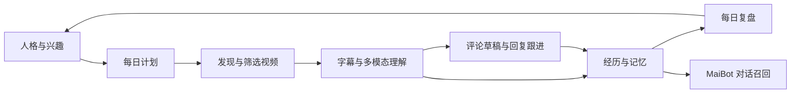

# MaiBot BiliLife · 麦麦的 B 站生活

[](https://github.com/Sakyurara/maibot-bililife/releases)
[](LICENSE)

**让麦麦拥有持续的 B 站浏览生活。**

BiliLife 是 MaiBot 插件：根据人格、兴趣与近期经历安排每日活动，发现和理解视频，选择是否参与评论，跟进自己的回复，并将有价值的内容保存为可检索记忆。所有操作通过 MaiBot WebUI 管理，支持按模块配置、TOML 编辑和持久化调度。

[下载安装包](https://github.com/Sakyurara/maibot-bililife/releases/latest) · [快速开始](#快速开始) · [配置说明](#配置说明) · [技术架构](#技术架构)

## 功能一览



| 模块 | 功能 | 可调整内容 |
| --- | --- | --- |
| 每日安排 | 24 小时钟面与时段环、任务详情、重新生成、自主追加、插入与删除日程 | 时区、计划时间、活跃时段、超时与重试 |
| 浏览与理解 | 自主选题与搜索、只读评论、UP 主内容、浏览和跳过记录 | 每日浏览量、时长、主题范围、媒体处理方式 |
| 评论与回复 | 草稿编辑、手动或自动发布、相关评论线程跟进、发布状态核对 | 评论与回复独立开关、每日额度、冷却、最大轮数 |
| 经历记忆 | 带来源的经历保存、检索、编辑、纠错与遗忘 | 记忆开关、召回数量、上下文长度 |
| 兴趣与人格 | 兴趣权重、人工干预、冻结维度、变更历史与回滚 | 自动兴趣变化、人格补充说明、表达偏好 |
| 模型 | 直接选择 MaiBot 模型，或配置独立提供商 | 文本、视觉、ASR、音频与视频分别路由 |
| 每日复盘 | 汇总实际经历、互动、记忆变化和资源消耗 | 复盘时间、可选推送会话 |
| 设置与维护 | 模块设置总览、账号扫码、运行记录、备份与配置导出 | 下载、缓存、存储、保留时间、模型预算 |

页面跟随 MaiBot 的主题与明暗设置。顶部提供“暂停全部任务”和“停止自动发布”，评论与回复分别控制，无需切换统一运行模式。

### 视频如何被理解

| 资料 | 用途 | 所需能力 |
| --- | --- | --- |
| 标题、简介与元数据 | 发现内容、判断是否继续了解 | 文本模型 |
| 可访问字幕 | 按时间戳提取观点与细节 | 文本模型 |
| 关键帧 | 理解画面、演示与视觉信息 | FFmpeg + 视觉模型 |
| 音频转录 | 无字幕时取得语音文本 | FFmpeg + ASR 模型 |
| 音频片段 | 理解语音与声音内容 | FFmpeg + 支持音频输入的模型 |
| 视频片段 | 综合理解有界片段的画面，可按配置包含音轨 | FFmpeg + 支持视频输入的模型 |

每条理解记录展示实际资料类型、时间范围、摘要、来源和缺失信息。只有标题与简介时显示为“元数据浏览”；字幕、抽帧与片段分析均保留覆盖范围。音视频处理采用受大小和时长限制的片段，不提供无限实时视频流。

## 快速开始

### 环境要求

| 组件 | 适配版本 / 要求 |
| --- | --- |
| MaiBot | 1.3.14 |
| 插件 SDK | maibot-plugin-sdk 2.16.0，Host / Runner v2 |
| Dashboard | 1.9.8，插件自定义页面 v2 |
| Python | 3.12 |
| FFmpeg | 关键帧、音频及视频片段处理需要 |
| 模型 | 至少配置文本模型；其他能力按需添加 |

插件内置 WebUI，无需额外部署前端服务、浏览器或数据库服务。

### 安装与首次配置

1. 从 [Releases](https://github.com/Sakyurara/maibot-bililife/releases) 下载同版本修复附件 `maibot-bililife-0.2.6-hotfix.zip`，并核对同页的 SHA256 文件。
2. 在 MaiBot WebUI 的插件管理中导入安装包并启用。
3. 打开 BiliLife 的**设置总览**，生成二维码，使用 B 站客户端完成独立扫码登录。
4. 打开**模型**，选择文本模型；需要画面理解时，再选择视觉模型。
5. 在**浏览与理解**设置主题、每日浏览量与媒体处理方式，在**每日安排**设置时间。
6. 生成日程并开始运行；在**评论与回复**查看草稿和发布状态。

GitHub 自动生成的 Source code ZIP 用于源码下载，安装请使用 Release 附件中的插件 ZIP。

默认每天最多浏览 **4 条视频 / 40 分钟**，评论上限 **1 条**、回复上限 **2 条**，**评论和回复自动发布均关闭**。额度是上限，不是每日必须完成的数量。

## 配置说明

常用设置在各模块页面直接保存。批量编辑可使用模块内的 TOML 编辑器，或在设置总览编辑整份业务配置。

### 1. 每日安排与浏览范围

以下为 `settings.toml` 的局部示例，完整字段见 [settings.example.toml](settings.example.toml)。

```toml
[schedule]
planner_enabled = true
timezone = "Asia/Shanghai"
adaptive_schedule_enabled = true
max_dynamic_tasks = 3
plan_time = "09:00"
active_start = "09:00"
active_end = "22:30"
task_timeout_seconds = 300
max_retries = 2

[browse]
browsing_enabled = true
max_videos = 4
max_comment_sessions = 4
max_comments_read = 12
max_video_seconds = 900
max_browse_seconds = 2400
allowed_topics = ["科学", "技术", "日常生活"]
excluded_topics = []
allowed_uploaders = []
video_understanding_mode = "frames"
max_frames = 3
enable_asr = false
segment_seconds = 90
max_download_mb = 40
daily_download_mb = 120
```

- 时间使用配置的业务时区；时长单位为秒，下载与存储大小单位为 MiB。
- `allowed_uploaders` 填数字 UID 字符串，留空时按兴趣主题发现内容，无需填写视频。
- 在钟面旁可插入指定时段的任务；重新生成计划会生成新版本，保留历史执行记录。
- 删除任务会取消并隐藏，恢复显示不会重新执行已取消的任务。
- 开启 `adaptive_schedule_enabled` 后，麦麦可根据刚完成的理解决定追加任务，也可不追加；每日最多 `max_dynamic_tasks` 项，任务在钟面标记为“麦麦自主追加”。
- 调度按顺序执行，界面不再提供固定为 1 的并发数选项。

可选择 `read_comments` 日程，只阅读兴趣主题下的评论区，不取得字幕、音频或画面。每日最多 `max_comment_sessions` 次，每次最多 `max_comments_read` 条。评论摘要、原文引用和来源单独保存，标明未观看视频，不据此生成视频评论。

在**浏览与理解 → 理解方式**选择一种媒体路径：`frames` 截取关键帧，`video` 提交视频片段，`audio` 提交音频片段，`subtitle` 仅使用可访问字幕与元数据。抽帧使用“关键帧视觉”模型，视频片段使用“直接视频理解”模型；两种方式不会同时执行。ASR 可另行启用，作为补充转录。

### 2. 模型选择与独立提供商

在**模型**页面为每项用途分别选择：

| 用途 | 负责内容 |
| --- | --- |
| 文本与规划 | 日程、筛选、摘要、互动决策、记忆与复盘 |
| 关键帧视觉 | 图片与抽样画面理解 |
| ASR 转录 | 语音转文字 |
| 直接音频理解 | 音频片段分析 |
| 直接视频理解 | 视频片段分析 |

**使用 MaiBot 已有模型：**直接在下拉框选择宿主配置中的模型名称并保存，插件在后端引用对应配置和凭据。无需重新输入宿主密钥。

模型路由也可在“配置模型选择”的 TOML 入口保存。将下面名称替换为 MaiBot 模型目录中的名称，而非服务商的模型 ID：

```toml
[routes]
text = "host:你的文本模型名称"
vision = "host:你的视觉模型名称"
asr = "disabled"
audio = "disabled"
video = "disabled"
```

**独立配置模型：**在模型页新增提供商，填写 Base URL、模型 ID、API Key、协议与输入能力。也可在该入口粘贴 TOML：

```toml
id = "custom_text"
name = "独立文本模型"
source = "custom"
protocol = "openai_compatible"
base_url = "https://api.example.com/v1"
model = "替换为服务商模型ID"
capabilities = ["text"]
api_key = "替换为你的APIKey"
```

保存后，在对应用途的下拉框选择该条目。`api.example.com` 是格式占位地址，需换成实际服务地址。提供商 TOML 应通过专用入口提交，密钥不填写到普通 `settings.toml`。

支持通用 `openai_compatible`、`qwen_compatible`、原生 `dashscope` 和原生 `gemini` 协议。输入能力须由服务本身支持；为条目勾选音频或视频不会改变模型能力。模型选定后，在**浏览与理解**选择对应理解方式。

**Qwen 视频模型：**在独立模型条目中选择“Qwen / 阿里云兼容”，使用服务的兼容 Base URL（阿里云通常以 `/compatible-mode/v1` 结尾），声明 `video` 能力。插件发送 Qwen 的视频输入格式及采样 FPS，默认关闭非流式请求的思考模式。需要原生接口时选择“DashScope 原生”，Base URL 应以 `/api/v1` 结尾；可设置 FPS 和最大采样帧数。完整示例见 [Qwen 提供商配置](provider.qwen.example.toml)。选择 MaiBot 已有模型时，在用途卡片设置协议；选择独立模型时，在该模型自己的编辑入口设置协议。

连接检查与日常生活额度独立，使用最小文本或合成媒体请求。成功显示请求往返延迟（ms），失败显示 HTTP 或本地错误码；检查本身仍可能产生服务商费用。

配置文件参考：[模型路由](model-routing.example.toml) · [独立提供商](provider.example.toml)。

### 3. 评论与回复

```toml
[comments]
comments_enabled = true
auto_publish_comments = false
owner_uid = ""
mention_owner = true
max_comments = 1
max_per_video = 1
cooldown_seconds = 3600

[replies]
replies_enabled = true
auto_publish_replies = false
max_replies = 2
max_thread_rounds = 2
user_cooldown_seconds = 21600
reply_interval_seconds = 3600
```

保留 `auto_publish_* = false` 时，生成的内容进入草稿，可在互动页面编辑和手动发布。需要自动发布时，分别启用评论或回复开关，并设置兴趣主题或 UP 主范围；启用后符合规则的发言直接执行，无需逐条确认。

所有发布入口共用账号状态、范围、上下文、额度、冷却和去重检查。回复默认只跟进本账号已发布评论及其相关线程；无新增信息时可以结束对话。请求结果未知时保留“待核对”状态，不直接重复提交。

填写 `owner_uid`（主人的数字 B 站 UID）后，`mention_owner = true` 会在视频评论中追加对主人的真实提及；留空时不提醒。回复链不重复追加主人提及。

### 4. 记忆、兴趣与复盘

```toml
[memory]
memory_enabled = true
recall_limit = 4
recall_chars = 2400

[persona]
evolution_enabled = true
persona_guidance = ""
expression_preferences = []

[review]
review_enabled = true
review_time = "22:00"
summary_stream_id = ""
```

在**兴趣与人格**页面调整具体主题的权重、冻结维度或回滚变化。`persona_guidance` 用于填写人工偏好，`expression_preferences` 用于填写表达倾向；这些设置不改写 MaiBot 的核心身份、权限和固定人格配置。

经历保存在插件记忆库，通过 `bililife_recall` 向 MaiBot 提供带来源的检索结果，并在可解析的会话中通过 `maisaka.context.append` 追加上下文。页面区分插件记忆、上下文追加和宿主长期记忆写入；当前适配版本不提供宿主长期记忆写入。

复盘仅汇总实际执行记录。`summary_stream_id` 留空时不向会话推送，填写目标会话标识后才启用对应推送。

### 5. 模型预算与存储

```toml
[models]
max_model_calls = 24
max_tokens = 70000
output_tokens = 1600
model_timeout_seconds = 100

[resources]
max_storage_mb = 256
retention_days = 60
cache_hours = 12
```

预算按业务日期结算，任务与手动操作共享额度。到达上限后停止新增对应消耗，状态显示在总览。提高浏览量或启用音视频处理时，应同步检查模型、下载和存储预算。

### 配置保存在哪里

| 文件 | 内容 | 修改方式 |
| --- | --- | --- |
| `config.toml` | SDK 插件启用与配置格式版本 | MaiBot 插件配置 |
| `settings.toml` | 模块开关、范围、日程、额度与偏好 | 模块表单或业务 TOML 编辑器 |
| `model-routing.json` | 模型条目与用途路由，不含 API Key | 模型页面 |
| `model-secrets.json` | 独立模型凭据 | 模型页面专用入口 |
| `credential.json` | 独立扫码获得的账号凭据 | 设置总览扫码 |
| `bililife.sqlite3` | 日程、任务、经历、互动、记忆与审计 | 插件自动管理 |

SDK 的 `config.toml` 由宿主管理；其余业务文件位于宿主分配的插件专属数据目录，标准布局为 `<MaiBot>/data/plugins/local.maibot-bililife/`。页面保存立即更新有效设置；直接修改 `settings.toml` 后需要重载插件。格式或字段错误不会覆盖上次有效配置，具体原因显示在总览。凭据仅保存在后端，不通过普通配置导出或前端响应回显。

## 技术架构

插件在 MaiBot 独立 Runner 内模块化运行，采用 SQLite WAL 存储，通过宿主认证的插件 API 桥接 WebUI 与后端。

| 层次 | 主要模块 | 职责 |
| --- | --- | --- |
| 宿主适配 | `maibot_adapter.py`、`plugin.py` | 生命周期、人格上下文、模型调用、检索工具与上下文追加 |
| 平台与媒体 | `bilibili_adapter.py`、`media_processor.py`、`video_understanding.py` | 账号、内容读取、异步转码、资料对齐与理解 |
| 计划与执行 | `daily_planner.py`、`task_executor.py` | 结构化计划、依赖关系、任务状态、取消、恢复与预算 |
| 互动 | `interaction_service.py` | 草稿、回复线程、发布策略、去重及 outbox 核对 |
| 记忆与偏好 | `memory_bridge.py` | 记忆检索、纠错、同步状态与兴趣变更 |
| 配置与界面 | `model_router.py`、`config_io.py`、`webui_service.py`、`webui/` | 模型路由、TOML、模块设置与中文界面 |
| 持久化 | `storage.py`、`migrations/` | 事务、迁移、执行记录与审计 |

调度使用持久化时间与状态，同日有效主计划唯一，任务领取由事务和本机执行锁保护。重启后恢复或处理过期任务，卸载时停止调度并释放客户端和子进程。媒体下载与 FFmpeg 异步执行，不长时间阻塞宿主事件循环。

发布操作在请求前写入 outbox；网络中断或超时后先核对平台状态，不能确认时保留未知状态。媒体地址受协议、域名与公网地址检查约束，外部字幕和评论仅作为待分析资料处理。

### 维护与升级

运行记录页提供数据库在线备份。升级前保留数据库与私有配置，使用版本化安装包更新，重载插件后保留既有任务和发布记录。完整安装、备份、恢复及卸载步骤见 [运维文档](docs/OPERATIONS.md)。

WebUI 源码位于 `webui/src/`，安装包包含 `webui/index.html`。从源码构建：

```bash
python scripts/build_webui.py
python scripts/package.py
```

## 开源协议

本项目采用 [MIT License](LICENSE)。

Copyright (c) 2026 Sakyurara and BiliLife contributors。复用平台客户端保留原作者版权和 [第三方许可证](vendor/LICENSE)，详见 [第三方说明](THIRD_PARTY.md)。
